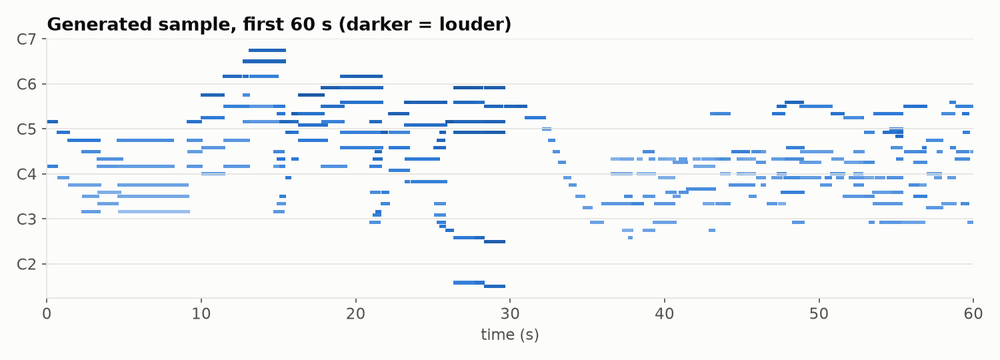
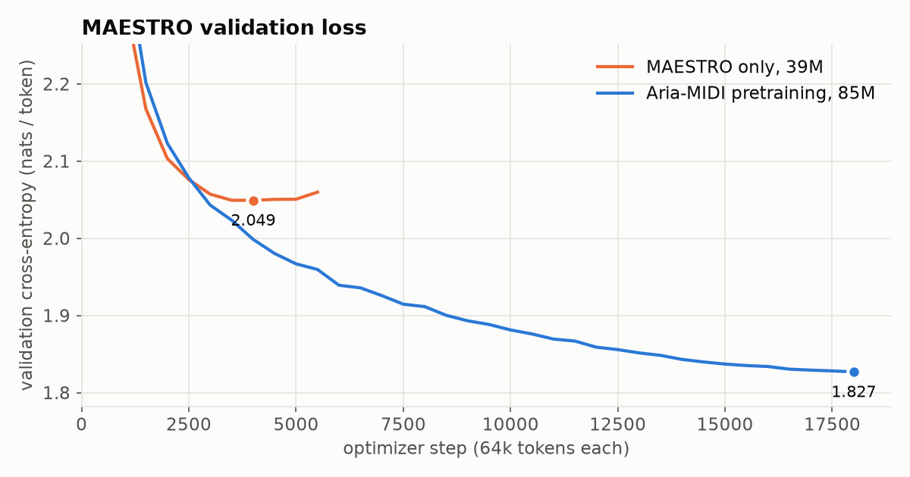

# Pianist

Pianist is an 85M-parameter decoder-only transformer that composes expressive solo piano
music. It models timing to 10 ms, dynamics and pedalled note lengths. It was pretrained on
4,700 hours of transcribed classical piano from
[Aria-MIDI](https://huggingface.co/datasets/loubb/aria-midi), fine-tuned on the human
performances in [MAESTRO v3](https://magenta.tensorflow.org/datasets/maestro) and evaluated on
MAESTRO's held-out test split. Audio is rendered with a sampled concert grand.

**Listen:**

- [`samples/sample-15.mp3`](samples/sample-15.mp3) is unconditional, chosen by an automatic
  screen rather than by ear.
- [`samples/nocturne-continuation-2.mp3`](samples/nocturne-continuation-2.mp3) is the model
  continuing the first 12 s of a held-out Chopin performance.

[`samples/`](samples/) explains how each sample was made and selected, and lists every
candidate, including the failures.



## Results

All numbers are on the 177 held-out MAESTRO v3 test performances: 2.83M target tokens, each
scored once, with no augmentation. They come from `pianist-evaluate`, and the raw output is in
[`docs/results/`](docs/results/).

| Model | Params | Training data | nats / token | perplexity | bits / note |
| --- | ---: | --- | ---: | ---: | ---: |
| Token bigram (count model, same grammar) | – | MAESTRO train | 3.571 | 35.6 | 19.68 |
| Transformer, MAESTRO only | 39M | MAESTRO train (22M tokens) | 1.970 | 7.17 | 10.85 |
| Transformer, Aria-MIDI pretraining | 85M | Aria-MIDI classical + MAESTRO train (496M tokens) | 1.759 | 5.81 | 9.69 |
| **+ MAESTRO fine-tuning (final)** | 85M | then MAESTRO train | **1.754** | **5.78** | **9.66** |

*Bits per note* is the total cost of encoding the test set divided by its number of notes, so
it doesn't depend on how many timing tokens a passage needs. For the final model, the
per-token cross-entropy is 1.36 nats for pitch, 1.89 for velocity, 1.85 for duration and 1.94
for timing. The bigram's figures are 4.35, 2.90, 3.69 and 3.30.



The data mattered more than anything else. The MAESTRO-only model stopped improving after
3,500 steps (about 10 augmented epochs), with training loss still falling: 159 hours is not
much music for a transformer. With 22× more data, validation loss fell for the whole
pretraining run. This comparison changes data and model size together, so it is not a
controlled ablation. Fine-tuning on MAESTRO afterwards helps only slightly (−0.005 nats) and
overfits within 250 steps.

### What the samples sound like, measured

The table compares all 16 unconditional samples with one random 92 s excerpt of each test
performance. These are descriptive sanity checks, not a measure of quality.

| | generated | real (test) |
| --- | ---: | ---: |
| notes per second | 8.5 | 11.1 |
| notes per onset (chord density) | 1.22 | 1.21 |
| mean / std pitch (MIDI number) | 62.2 / 10.9 | 64.2 / 12.2 |
| pitch range (semitones) | 56 | 61 |
| mean / std velocity | 61.8 / 15.4 | 63.4 / 16.4 |
| median note length (s, pedal included) | 0.46 | 0.34 |
| pitch-class entropy (bits) | 2.90 | 3.27 |

### Limitations and failure cases

- **Most samples have a visible flaw.** Only 3 of 16 unconditional samples pass the automatic
  screen in [`samples/`](samples/README.md). The failures:
  - Five contain more than 3 s with no note sounding. Real 90 s excerpts do this only 4% of
    the time, so the model over-predicts long rests.
  - Three fall into loops or trills over a few pitch classes.
  - Several stay in a narrow register. Compared with real playing, the output is sparser, with
    longer notes and lower harmonic variety.
- **There is no long-range form.** Phrases, cadences and textures are convincing locally,
  but nothing returns or develops over minutes. The 2,048-token context covers roughly 525
  notes (about 45–60 s), and longer pieces continue from a sliding window that forgets what
  came before.
- **The pretraining data is transcribed.** Aria-MIDI comes from automatic transcription of
  recordings, so its velocities and pedalling are noisier than MAESTRO's Disklavier captures.
- **Leakage control is heuristic.** Aria-MIDI may contain other recordings of MAESTRO's
  test pieces, including the competition performances themselves. Any Aria file sharing more
  than 4% of its pitch 8-grams with a MAESTRO validation or test performance is removed;
  1,564 files were dropped this way. On MAESTRO, unrelated pieces never exceed 3% overlap,
  while different performances of the same composition usually exceed 12%. This makes the
  splits composition-disjoint in the same spirit as MAESTRO's own, but it is not a guarantee.
- **The evaluation is likelihood-based.** There is no listening study. The 2024 version's
  fine-tuning from listener ratings is not reproduced here.
- **Rendering is a SoundFont.** It has no sympathetic string resonance or pedal noise, and
  folding the pedal into note lengths loses half-pedalling.

## How it works

```
MIDI ──► notes (+ sustain pedal) ──► tokens ──► transformer ──► tokens ──► MIDI ──► FluidSynth ──► audio
```

### Data

[`pianist/data.py`](pianist/data.py) handles both datasets.

| Corpus | Performances | Hours | Notes | Tokens | Use |
| --- | ---: | ---: | ---: | ---: | --- |
| MAESTRO v3 train | 962 | 159 | 5.7M | 21.7M | pretraining and fine-tuning |
| MAESTRO v3 validation | 137 | 20 | 0.6M | 2.5M | checkpoint selection |
| MAESTRO v3 test | 177 | 20 | 0.7M | 2.8M | final evaluation only |
| Aria-MIDI deduped, `classical`, audio score ≥ 0.95 | 74,111 | 4,726 | 122.8M | 473.8M | pretraining |

MAESTRO's official splits never share a composition. `pianist-prepare --aria` downloads both
corpora and filters Aria-MIDI by genre and by the dataset's transcription audio-quality score.
It removes anything that overlaps MAESTRO's validation or test sets, then stores each corpus
as compact arrays (10 bytes per note) that the data-loader workers share.

### Tokenization

[`pianist/tokenizer.py`](pianist/tokenizer.py) first folds the sustain pedal into note
lengths, so a note sounds until its key *and* the pedal are released, or until the key is
struck again. Each note then becomes a short group of tokens:

```
[SHIFT ...]  PITCH  VELOCITY  DURATION
```

- `SHIFT` advances the onset clock in 10 ms steps, up to 1 s per token. Chord notes share an
  onset and cost no shift.
- `PITCH` is one of the 88 keys and `VELOCITY` one of 32 dynamic levels.
- `DURATION` is one of 64 log-spaced bins from 10 ms to 10 s, with a median round-trip error
  of about 3%.

The vocabulary has 287 tokens, averaging 3.9 tokens per note. The grammar
`BOS (SHIFT* PITCH VELOCITY DURATION)* EOS` is enforced during sampling, so every generated
note is well formed.

### Model

[`pianist/model.py`](pianist/model.py) is a modern decoder:

- 12 layers, d<sub>model</sub> 768 and 12 heads
- pre-norm RMSNorm, rotary position embeddings, QK-norm and SwiGLU MLPs
- fused scaled-dot-product (flash) attention and tied embeddings
- a KV cache for generation

### Training

[`pianist/train.py`](pianist/train.py):

- **Windows and augmentation.** The model trains on random 2,048-token windows that start on
  note boundaries. Each window is transposed by up to ±5 semitones and time-stretched by up to
  ±5% before tokenizing.
- **Optimizer.** AdamW (β = 0.9, 0.95; weight decay 0.1, applied to matrices only), with
  gradient clipping at 1.0, dropout 0.1, bf16 autocast and `torch.compile`. Each step covers
  64k tokens.
- **Pretraining.** 18,000 steps (1.18B tokens, about 2.4 epochs) with 1,000 warmup steps and
  cosine decay from 6e-4 to 6e-5. It took 2 h 53 min on one RTX 5080 at 117k tokens/s.
- **Fine-tuning.** 1e-4 decaying to 1e-5 on MAESTRO train, stopped by validation loss after
  three evaluations without improvement. The best checkpoint is at step 250.

### Sampling

[`pianist/sampling.py`](pianist/sampling.py) uses nucleus sampling (top-p 0.95, temperature
1.0) under the token grammar.

- A minimum note count keeps a piece from ending early.
- Pieces longer than the context continue from a sliding window, which re-encodes the most
  recent half of the context, cut at a note boundary.
- `--max-seconds` ends a piece at its longest pause in the final 15%, so it stops between
  phrases.
- Generation can also continue the opening of any MIDI file.

The model produces about 100 tokens/s, roughly 25 notes/s, which is faster than real-time
playback.

### Rendering

[`pianist/render.py`](pianist/render.py) plays the MIDI through
[FluidSynth](https://www.fluidsynth.org/) with the
[Salamander Grand Piano](https://freepats.zenvoid.org/Piano/acoustic-grand-piano.html), a
Yamaha C5 sampled at 16 velocity layers, plus hall reverb. Every note rings for its full release
while later notes start. FFmpeg then trims the silent tail and normalizes loudness to -16 LUFS.

## Quickstart

You need [uv](https://docs.astral.sh/uv/). For audio, you also need `fluidsynth` and `ffmpeg`:
use `apt install fluidsynth ffmpeg`, `brew install fluid-synth ffmpeg` or
`conda install -c conda-forge fluidsynth ffmpeg`.

```bash
git clone https://github.com/SamuelReeder/piano.git && cd piano
uv sync --extra cu128 --extra viz            # or --extra cpu
uv run pianist-prepare --aria                # MAESTRO (58 MB) + Aria-MIDI (2 GB); ~6 min to parse
uv run python -m pianist.render --download   # Salamander Grand Piano SoundFont (296 MB)

uv run pianist-train --run pretrain --train-data aria,train   # about 3 h on an RTX 5080
uv run pianist-train --run finetune --init checkpoints/pretrain/best.pt --train-data train \
    --steps 3000 --lr 1e-4 --min-lr 1e-5 --warmup 200 --eval-every 250 --patience 3

uv run pianist-generate checkpoints/finetune/best.pt --num 4 --render mp3 --out-dir outputs
uv run pianist-generate checkpoints/finetune/best.pt --prompt some_piece.mid --prompt-seconds 10
uv run pianist-evaluate checkpoints/finetune/best.pt --samples outputs
```

- `make setup data soundfont pretrain finetune samples evaluate figures` wraps the same steps.
- Every training option is a flag (`pianist-train --help`). The MAESTRO-only baseline is
  `pianist-train --run maestro-only --d-model 512 --n-heads 8 --batch-size 16 --grad-accum 2`.
- The trained weights (340 MB) are not stored in git.
- The tests (`uv run pytest`) run on CPU in seconds. They cover:
  - tokenizer and MIDI round trips, and sustain-pedal handling
  - causal masking and KV-cache equivalence
  - grammar-constrained sampling, dataset windows and the leakage filter

```
pianist/
  tokenizer.py   MIDI ⇄ notes ⇄ tokens, sustain pedal, sampling grammar
  data.py        MAESTRO and Aria-MIDI preparation, leakage filter, training/eval windows
  model.py       transformer and KV cache
  sampling.py    grammar-constrained nucleus sampling with a sliding context
  train.py       training loop (bf16, torch.compile, cosine schedule, early stopping)
  generate.py    CLI: checkpoint → MIDI (+ MP3/WAV)
  evaluate.py    CLI: test-set likelihoods, bigram baseline, sample statistics
  render.py      FluidSynth rendering
scripts/         README figures, sample screening
samples/         generated audio and MIDI, with settings and selection notes
tests/           pytest suite (CPU)
```

## History

The first version dates from 2024 and remains in the git history up to `7ad88c7`. It was a
small nanoGPT-style model trained on note names from 100+ classical pieces. It predicted
durations and velocities as regression targets. Audio was made by concatenating one recorded
WAV per note, so each note was cut off when the next one began.

Version 2 rebuilds every stage:

- public datasets with official splits
- an event tokenization with real timing, pedal and polyphony
- a modern architecture, pretrained at scale
- held-out evaluation against a baseline
- a proper synthesizer for audio

## Credits and licenses

- **Code:** MIT, see [LICENSE](LICENSE).
- **MAESTRO v3:** Hawthorne et al., *Enabling Factorized Piano Music Modeling and Generation
  with the MAESTRO Dataset*, ICLR 2019, licensed
  [CC BY-NC-SA 4.0](https://creativecommons.org/licenses/by-nc-sa/4.0/).
- **Aria-MIDI:** Bradshaw & Colton, *Aria-MIDI: A Dataset of Piano MIDI Files for Symbolic
  Music Modeling*, ICLR 2025, licensed CC BY-NC-SA 4.0. Its transcriptions may include
  third-party copyrighted compositions; see the dataset's disclaimer.
- **Weights and samples:** treat trained weights and generated samples as derived from these
  datasets, for non-commercial use.
- **Salamander Grand Piano:** by Alexander Holm, SF2 conversion by FreePats, licensed
  [CC BY 3.0](https://creativecommons.org/licenses/by/3.0/).
